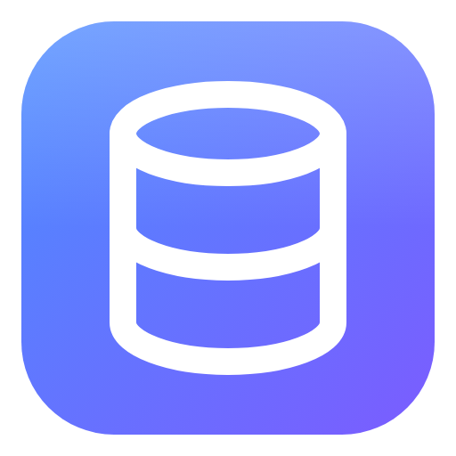
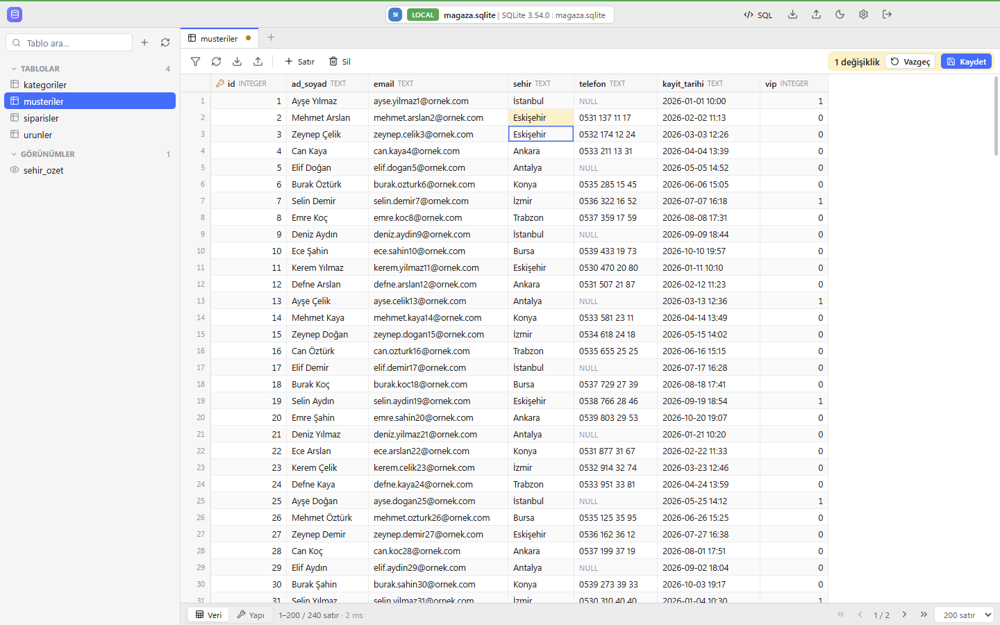
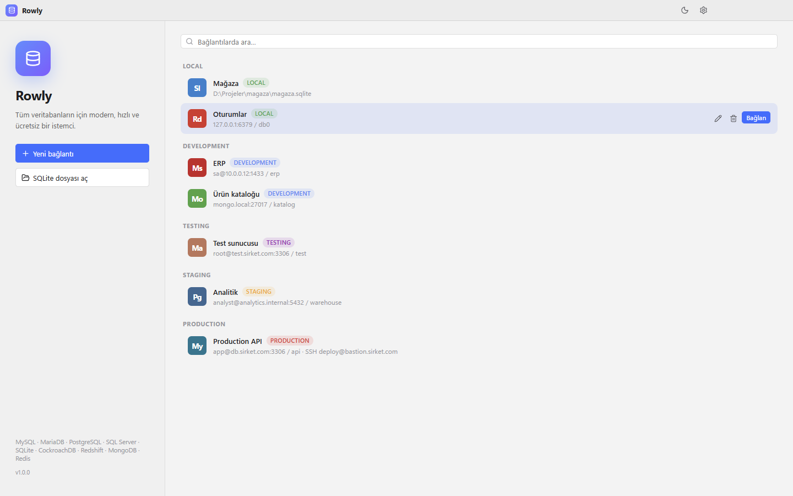
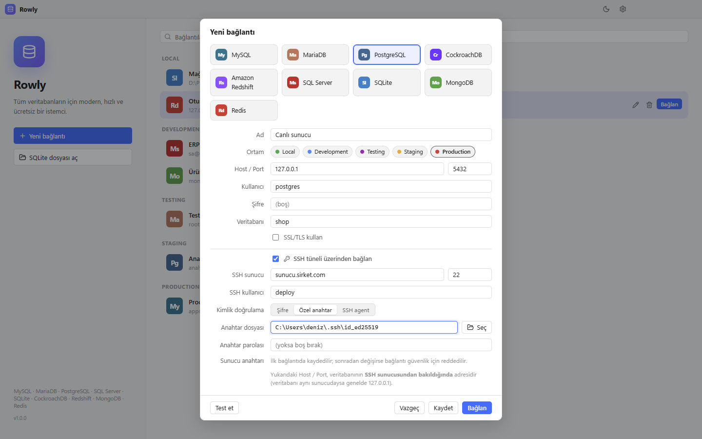
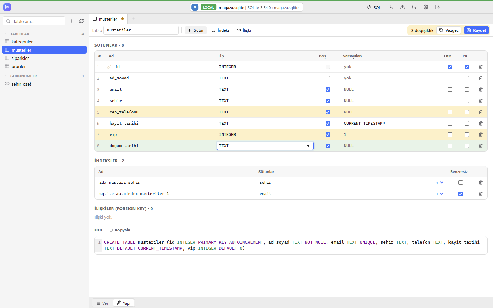
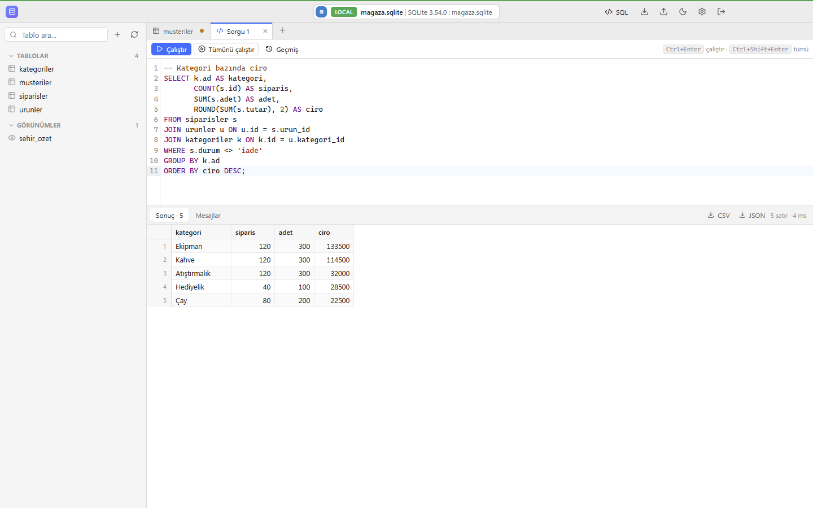
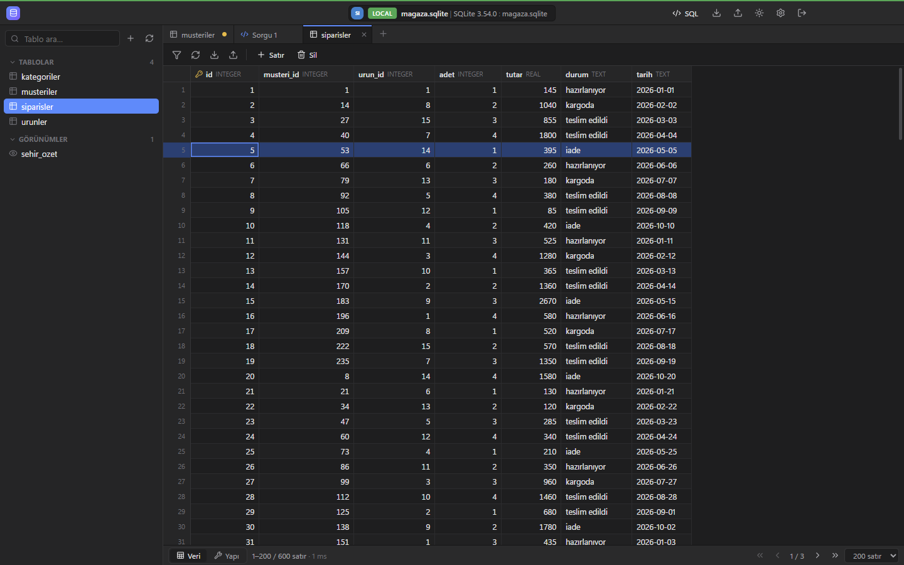
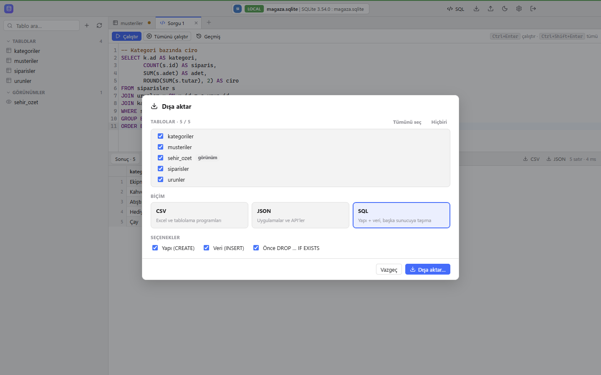

<p align="center">
  
</p>

<h1 align="center">Rowly</h1>

<p align="center">
  Tüm veritabanların için modern, hızlı ve <b>ücretsiz</b> bir masaüstü istemcisi.<br />
  MySQL, MariaDB, PostgreSQL, SQL Server, SQLite, MongoDB ve Redis tek uygulamada.
</p>

<p align="center">
  <a href="https://github.com/Muhammed61/rowly-releases/releases/latest"><b>⬇ İndir: Windows (.exe) · macOS (.dmg) · Linux (.deb, AppImage)</b></a>
</p>



## Neden Rowly?

TablePlus gibi araçların sade ve hızlı kullanımını sevip ücretli lisans ödemek istemeyenler için yazıldı. Rowly tamamen ücretsiz ve açık kaynaklıdır; tablo veya bağlantı sayısı sınırı yoktur. Arayüzü Türkçedir.

## Kurulum

**Windows:** [Releases](https://github.com/Muhammed61/rowly-releases/releases/latest) sayfasından `Rowly-Setup-x.y.z.exe` dosyasını indirip çalıştırın. Kurulum yönetici izni istemez. Dosya imzasız olduğu için Windows SmartScreen uyarı verebilir: **Ek bilgi → Yine de çalıştır** deyin.

**macOS:** Apple Silicon (M1/M2/M3/M4) için `Rowly-x.y.z-arm64.dmg`, Intel Mac için `Rowly-x.y.z-x64.dmg` dosyasını indirin, açın ve Rowly'yi **Uygulamalar** klasörüne sürükleyin. Uygulama Apple sertifikasıyla imzalı olmadığı için ilk açılışta uyarı çıkar: **Sistem Ayarları → Gizlilik ve Güvenlik → Yine de Aç**. "Hasarlı" uyarısı çıkarsa Terminal'de bir kez `xattr -cr /Applications/Rowly.app` çalıştırın. macOS 12 veya üstü gerekir. Mac'te kısayollar Ctrl yerine Cmd ile çalışır.

**Linux (Debian / Ubuntu / Kali):** `Rowly-x.y.z-amd64.deb` (ARM cihazlarda `arm64.deb`) dosyasını indirip `sudo apt install ./Rowly-x.y.z-amd64.deb` ile kurun, menüden ya da `rowly` komutuyla açın. Root kullanıcısıyla açarken `rowly --no-sandbox` gerekir. Kurulumsuz kullanım için `.AppImage` dosyası da var (`libfuse2` gerekir).

### İndirilen dosyayı doğrulama

Her kurulum dosyası için iki doğrulama yolu vardır:

**1. SHA256 özeti:** dosyanın indirirken bozulmadığını veya değiştirilmediğini gösterir. Sürüm sayfasındaki `SHA256SUMS.txt` içindeki değerle karşılaştırın:

- Windows (PowerShell): `Get-FileHash .\Rowly-Setup-x.y.z.exe -Algorithm SHA256`
- macOS: `shasum -a 256 Rowly-x.y.z-arm64.dmg`
- Linux: `sha256sum -c SHA256SUMS.txt --ignore-missing`

**2. Derleme kanıtı:** dosyanın bu depodaki açık kaynak koddan, GitHub Actions'ta derlendiğini kanıtlar. Kanıt Sigstore ile imzalıdır ve GitHub'da herkese açık saklanır. [GitHub CLI](https://cli.github.com) kuruluysa:

```
gh attestation verify Rowly-Setup-x.y.z.exe --repo Muhammed61/rowly
```

Komut `Verification succeeded` derse dosya bu depodaki koddan derlenmiştir ve sonradan değiştirilmemiştir.

## Özellikler

### Desteklenen veritabanları

| Veritabanı | Gezinme ve düzenleme | Sorgu | Yapı düzenleme | Dışa / içe aktarma |
|---|---|---|---|---|
| MySQL, MariaDB | ✓ | SQL | ✓ | CSV, JSON, SQL |
| PostgreSQL, CockroachDB, Redshift | ✓ | SQL | ✓ | CSV, JSON, SQL |
| SQL Server | ✓ | SQL (GO paketleri) | ✓ | CSV, JSON, SQL |
| SQLite | ✓ | SQL | ✓ | CSV, JSON, SQL |
| MongoDB | ✓ (tipler korunur) | mongosh sözdizimi | — | JSON (EJSON), CSV |
| Redis | ✓ (tüm tipler) | Redis komutları | — | JSON, CSV |

### Neler yapabilirsiniz?

- **Bağlantı yöneticisi:** Bağlantıları Local / Development / Testing / Staging / Production olarak etiketleyin; production bağlantılarında veri değiştiren her işlemden önce onay istenir. Şifreler işletim sisteminin güvenli kasasında şifreli saklanır.
- **SSH tüneli:** Uzak sunuculardaki veritabanlarına SSH üzerinden bağlanın; şifre, özel anahtar (OpenSSH / PEM / PuTTY, parolalı da olur) veya SSH agent (Pageant) desteklenir. Sunucu anahtarı ilk bağlantıda kaydedilir, sonradan değişirse bağlantı güvenlik için reddedilir.
- **Veri tablosu:** Büyük tablolarda bile akıcı kaydırma (sayfa başına 5.000 satıra kadar), sıralama, sayfalama, çoklu filtre (Türkçe karakterlere duyarlı "içerir" araması). Hücreyi çift tıklayıp düzenleyin, satır ekleyin, çoğaltın, silin; değişiklikler renklerle işaretlenir ve **Ctrl+S** ile tek işlemde kaydedilir.
- **Yapı düzenleme:** Sütun ekleme / silme / yeniden adlandırma, tip, NULL, varsayılan değer, otomatik artan, birincil anahtar ve açıklama değiştirme; indeks ve ilişki (foreign key) yönetimi; yeni tablo oluşturma. Çalışacak SQL uygulanmadan önce gösterilir.
- **SQL editörü:** Sözdizimi renklendirme, tablo adı tamamlama, imleçteki ifadeyi ya da tümünü çalıştırma, birden fazla sonuç sekmesi, sorgu geçmişi, sonucu CSV / JSON kaydetme.
- **Dışa / içe aktarma:** Tablo, filtreli görünüm ya da tüm veritabanı → CSV (Türkçe Excel için ; ayraç), JSON veya başka sunucuya taşınabilir SQL dökümü. CSV / JSON / SQL dosyalarını önizleme ve otomatik sütun eşlemeyle içe aktarma; Türkçe ondalık virgül (`1.234,56`) desteği.
- **Görünüm:** Açık / koyu tema, arayüz ve tablo yazı boyutu, sabit genişlikli yazı tipi seçeneği, satır yoğunluğu.
- **Otomatik güncelleme:** Yeni sürüm çıktığında uygulama içinde bildirim görünür; tek tıkla güncellenir.

| Bağlantılar | Yeni bağlantı ve SSH tüneli |
|---|---|
|  |  |

| Tablo yapısını düzenleme | SQL editörü |
|---|---|
|  |  |

| Koyu tema | Dışa aktarma |
|---|---|
|  |  |

### Kısayollar

| Kısayol | İşlev |
|---|---|
| Ctrl+T | Yeni sorgu |
| Ctrl+Enter | İmleçteki ifadeyi / seçimi çalıştır |
| Ctrl+Shift+Enter | Tümünü çalıştır |
| Ctrl+S | Değişiklikleri kaydet (veri veya yapı) |
| Ctrl+R / F5 | Veriyi yenile |
| Ctrl+F | Filtre |
| Ctrl+I | Satır ekle |
| Del | Seçili satırları sil |
| Ctrl+W | Sekmeyi kapat |
| Ctrl+Tab | Sonraki sekme |

## Güncellemeler

Rowly yeni sürümleri kendisi denetler. Yeni sürüm çıktığında ekranın üstünde bildirim görünür; Ayarlar (⚙) panelinden de elle denetleyebilirsiniz. Bağlantılarınız ve ayarlarınız korunur.

- **Windows:** **Şimdi güncelle** dediğinizde indirilir, kurulur ve uygulama yeniden açılır.
- **Linux:** .deb kurulumunda yönetici parolanız sorulur, ardından güncellenip yeniden açılır. AppImage kendini parola sormadan günceller.
- **Mac:** **İndir** dediğinizde yeni .dmg dosyası tarayıcıda iner; açıp Rowly'yi yine Uygulamalar klasörüne sürükleyin.

## Geliştirme

Electron + React + TypeScript ile yazılmıştır.

```
npm install
npm run dev        # geliştirme modu (canlı yenileme)
npm run typecheck  # tip kontrolü
npm run dist       # Windows kurulum dosyası (release/ klasörüne)
```

Bir Mac'te `npm run dist:mac`, Linux'ta `npm run dist:linux` ile o sistemin kurulum dosyaları üretilir. Uygulama ikonu `build/icon.svg` dosyasından `npm run icon` ile üretilir.

### Sürüm yayınlama

`package.json` içindeki sürümü artırıp aynı adla etiket gönderin (ör. `v1.0.1`):

```
git tag v1.0.1
git push origin v1.0.1
```

GitHub Actions Windows, macOS ve Linux kurulum dosyalarını derleyip public [rowly-releases](https://github.com/Muhammed61/rowly-releases) deposuna yükler; kurulu uygulamalar yeni sürümü kendiliğinden bulur. Bunun için bu depoda `RELEASES_TOKEN` secret tanımlı olmalı (rowly-releases için Contents: Read and write).

### Klasör yapısı

- `src/main/`: Electron ana süreç — veritabanı sürücüleri (`drivers/`), SSH tüneli, dışa / içe aktarma, otomatik güncelleme, bağlantı deposu
- `src/preload/`: Arayüze açılan güvenli API
- `src/renderer/`: React arayüzü
- `src/shared/`: Ortak tipler, SQL lehçeleri ve yapı değişikliği (ALTER / CREATE) üreteci

Yeni bir veritabanı eklemek için `src/main/drivers/base.ts` içindeki `Driver` sınıfından türeyen bir sürücü yazıp `drivers/index.ts` içine kaydetmek yeterlidir.

Bağlantılar `%APPDATA%\Rowly\connections.json` (Windows), `~/Library/Application Support/Rowly/connections.json` (macOS) veya `~/.config/Rowly/connections.json` (Linux) dosyasında saklanır; şifreler işletim sisteminin kasasıyla şifrelenir.

## Katkıda bulunma

Rowly açık kaynaklıdır; hata bildirimleri, öneriler ve katkılar memnuniyetle karşılanır.

- **Hata veya öneri:** [Issues](https://github.com/Muhammed61/rowly/issues) bölümünden yeni bir kayıt açın. Hatayı nasıl tekrarlayabileceğimizi, işletim sisteminizi, veritabanı türünü ve Rowly sürümünüzü (Ayarlar ⚙ → Güncellemeler) yazın.
- **Kod katkısı:** Depoyu fork'layın, değişikliğinizi ayrı bir dalda yapın ve Pull Request gönderin. Arayüz metinleri Türkçedir; yeni metinleri de Türkçe yazın.
- **Güvenlik açığı:** Rowly veritabanı şifrelerinizi ve SSH anahtar yollarınızı sakladığı için güvenlik açıklarını herkese açık Issue olarak yazmayın. GitHub'daki **Security → Report a vulnerability** bölümünden gizli olarak bildirin.

## Lisans

[MIT](LICENSE). Electron, React, CodeMirror, sql.js, ssh2 ve her veritabanının resmi Node.js sürücüsüyle geliştirildi.
